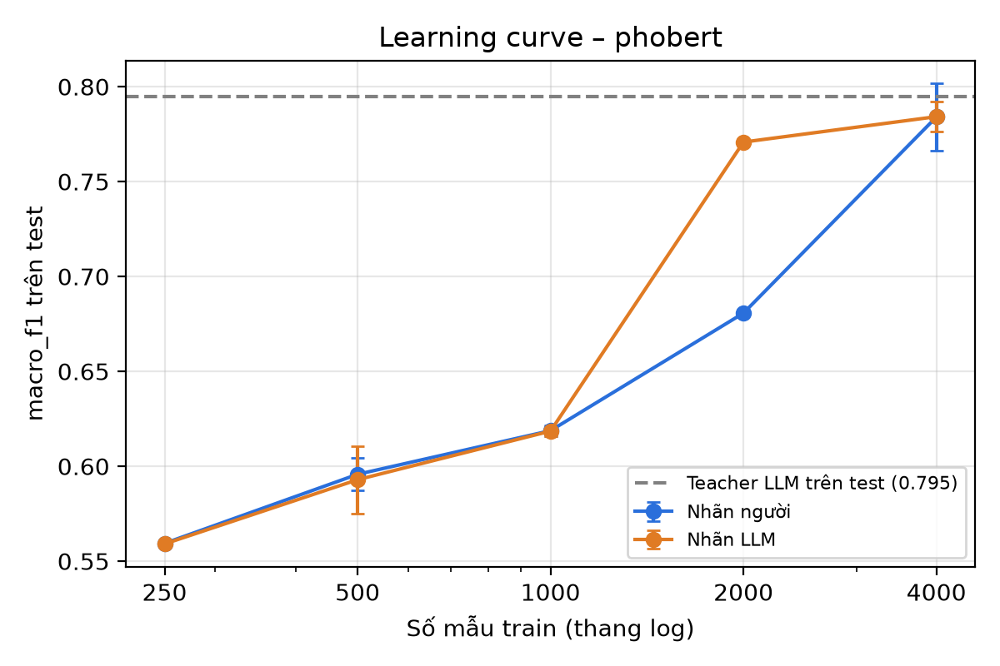
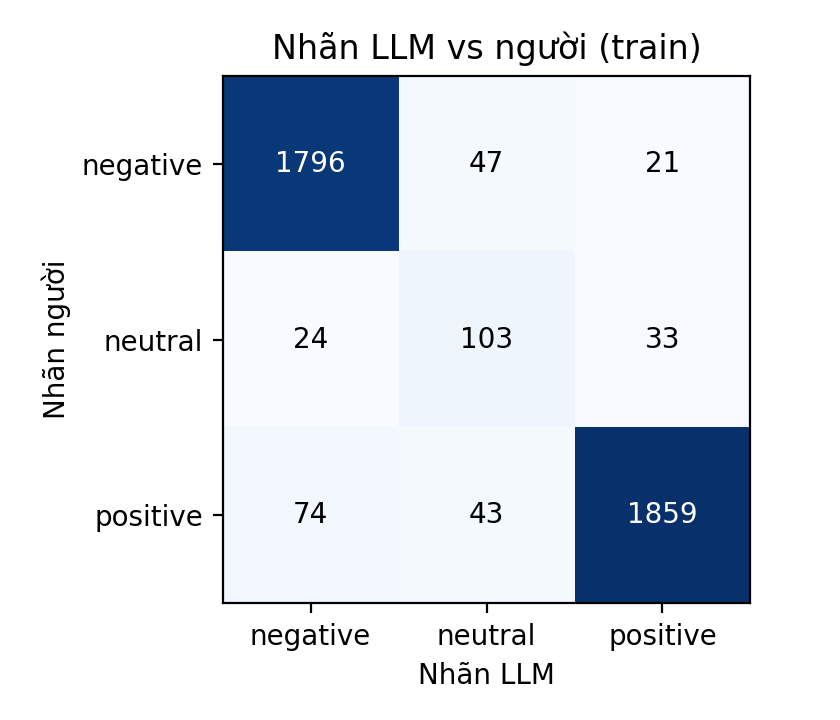
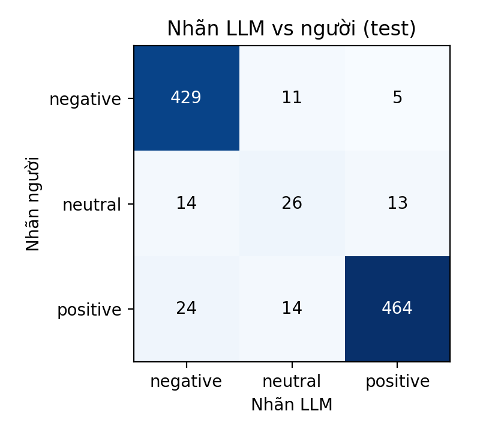
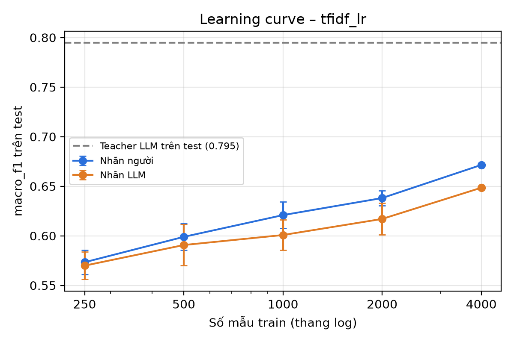

# LLM Labeling for Vietnamese Sentiment Classification

A two-person project evaluating whether LLM-generated labels can train smaller Vietnamese sentiment classifiers that approach human-label training performance.

**Project at a glance**

- **Task and data:** three-class sentiment classification on 5,300 fixed UIT-VSFC sentences; students are TF-IDF + Logistic Regression and PhoBERT.
- **Teacher:** `gpt-6-luna` achieves **0.7946 test macro-F1** and **91.90% accuracy**.
- **PhoBERT at 4,000 examples:** **0.7842 ± 0.0078** with LLM labels versus **0.7840 ± 0.0176** with human labels across three seeds; neither result establishes that LLM labels are better, and the LLM-trained student remains below its teacher.
- **TF-IDF at 4,000 examples:** LLM labels score **0.6485**, compared with **0.6715** for human labels, a gap of **2.30 macro-F1 percentage points**.
- **Practical cost:** approximately **USD 0.20 for about 10,000 labeling calls**, as reported by the team for its OpenAI API/“Build” setup; Section 3.5 explains the scope and available records.



The teacher assigns `negative`, `neutral`, or `positive` to each original Vietnamese sentence. Students learn from these discrete labels; the experiments do not use teacher probabilities, logits, or a KL-divergence distillation objective. All teacher and student test metrics use the same human reference labels.

Results were checked on **October 17, 2026**. Scores are on a 0–1 scale. `±` denotes the **sample standard deviation across seeds**, not a confidence interval. For configurations with one seed, tables report the score alone rather than assigning a standard deviation of zero. Figure labels remain in Vietnamese; Section 5.2 explains them and the seed counts.

## 1. Research Questions

1. How closely do LLM labels agree with human labels, and how does replacing human labels affect student performance?
2. Approximately how many LLM labels are needed to match a student trained on 1,000 human labels?
3. Can a student trained on 4,000 LLM labels outperform its LLM teacher on the same test set?

Additional experiments examine **filtering examples on which both prompts agree** (`llm_agree`) and **combining 500 human labels with LLM labels** (`mix500`).

## 2. Dataset and Evaluation Protocol

We use the **sentiment classification** task from [UIT-VSFC on Hugging Face](https://huggingface.co/datasets/uitnlp/vietnamese_students_feedback), a corpus of Vietnamese student feedback. The dataset's topic labels are not used in this project.

The fixed subset contains **5,300 sentences**. The class counts below are computed directly from the committed [data/data.csv](data/data.csv). Per-class metrics can be reproduced with [analyze_labels.py](analyze_labels.py).

| Split | Negative | Neutral | Positive | Total | Purpose |
| --- | ---: | ---: | ---: | ---: | --- |
| Train | 1,864 | 160 | 1,976 | 4,000 | Pool for student training subsets |
| Dev | 134 | 14 | 152 | 300 | Teacher prompt evaluation and selection |
| Test | 445 | 53 | 502 | 1,000 | Evaluation of the teacher and all students against human labels |

Neutral accounts for only **4.00% of train**, **4.67% of dev**, and **5.30% of test**. The primary metric is therefore **macro-F1**, which gives equal weight to the F1 score of each class. Accuracy and Cohen's kappa are additional metrics.

The committed [prepare_data.py](prepare_data.py) uses seed 42, stratified sampling, and the corresponding original train, validation, and test splits. It removes duplicate text within each original split and excludes dev/test text from the training pool. The resulting `data/data.csv` remains fixed throughout the project and is shared by both team members.

Experimental rules:

- Select the teacher prompt using **dev macro-F1**. Do not use the test set to select or revise prompts.
- For a given seed and sample size, `human` and `llm` use the same training sentences. Smaller training subsets are nested within larger subsets under the design in `common.py`.
- Evaluate all models against **human test labels**. LLM labels for test sentences are used only to measure teacher performance, not to train students.
- Treat human labels as the evaluation reference while acknowledging that some examples may be ambiguous or require review.
- Interpret `llm_agree` with care: filtering changes the selected sentences as well as the label source.

## 3. Teacher and Prompt Selection

### 3.1. Configuration and Outputs

| Component | Team configuration |
| --- | --- |
| API provider | OpenAI |
| Base URL | `https://api.openai.com/v1` |
| Model | `gpt-6-luna` |
| API key | Environment variable `LLM_API_KEY` |
| Prompts | `v1`, `v2`, defined in [label_llm.py](label_llm.py) |
| Generation settings | `temperature=0`, `reasoning_effort="none"` |
| Request workers | `WORKERS = 1` |
| Label files | `data/llm_v1.csv`, `data/llm_v2.csv` |
| Labels used by students | `data/llm_final.csv`, copied from v2 |

Each Luna prompt has **5,300 labeled sentences**, with `INVALID = 0`. The committed CSV files match their corresponding Luna cache records for every ID, label, and raw response. `data/llm_final.csv` matches `data/llm_v2.csv` and all **5,300 labels** in [gpt-6-luna_v2.jsonl](llm_cache/gpt-6-luna_v2.jsonl), with no missing IDs or label mismatches. All final teacher/student results reported below use the Luna labels. Earlier Gemini trials are documented separately in Section 3.4.

The exact system message and both prompt templates are committed in [label_llm.py](label_llm.py), under `SYSTEM` and `PROMPTS`. v1 gives basic sentiment classification instructions. v2 adds explicit labeling conventions and four examples, including a negative label for suggestions for improvement. The prompt examples are described in the source as manually written rather than taken from test data. Git history shows the same prompt strings across the initial, Gemini, and Luna code revisions.

<details>
<summary>Exact prompts used by the labeling script (Vietnamese)</summary>

**System message**

```text
Bạn là người gán nhãn dữ liệu cẩn thận. Chỉ trả lời đúng một từ.
```

**Prompt v1**

```text
Phân loại cảm xúc của câu phản hồi sau của sinh viên về môn học/giảng viên.
Trả lời đúng MỘT từ: negative, neutral hoặc positive.

Câu: {text}
Nhãn:
```

**Prompt v2**

```text
Phân loại cảm xúc của câu phản hồi sau của sinh viên về môn học/giảng viên/cơ sở vật chất.

Hướng dẫn:
- positive: khen, hài lòng, cảm ơn, chúc, mong được học tiếp với giảng viên.
- negative: chê, phàn nàn, VÀ cả các góp ý/đề xuất cải thiện (câu có "nên", "cần", "mong ... hơn") vì chúng ngụ ý hiện tại chưa tốt.
- neutral: chỉ kể sự việc hoặc nói về bản thân, không đánh giá tốt/xấu.

Ví dụ:
Câu: cô giảng bài rất dễ hiểu . -> positive
Câu: phòng học nóng , máy chiếu bị mờ . -> negative
Câu: thầy nên cho thêm bài tập về nhà . -> negative
Câu: em học môn này vào học kỳ hè . -> neutral

Trả lời đúng MỘT từ: negative, neutral hoặc positive.
Câu: {text}
Nhãn:
```

`{text}` is replaced with the original Vietnamese feedback. The prompts remain in their original language for reproducibility.

</details>

### 3.2. Dev Results Used for Prompt Selection

| Prompt | Sentences | INVALID | Accuracy | Macro-F1 | Kappa |
| --- | ---: | ---: | ---: | ---: | ---: |
| v1 | 300 | 0 | 0.8433 | 0.7135 | 0.7279 |
| **v2** | **300** | **0** | **0.9100** | **0.7578** | **0.8350** |

We selected **v2** because dev macro-F1 improved by **0.0443**, or **4.43 percentage points**. These values were independently recomputed from the committed Luna caches and the fixed dev set; the v2 dev results also match `teacher.csv`.

The committed Luna v1 labels additionally yield macro-F1 of **0.7460 on train** and **0.7254 on test**. Corresponding accuracy values are 0.8775 and 0.8580, and kappa values are 0.7799 and 0.7459. These are descriptive results from the completed runs, not the basis for prompt selection.

### 3.3. Teacher v2 Performance

Sources: [teacher.csv](results/teacher.csv), [llm_final.csv](data/llm_final.csv), and [analyze_labels.py](analyze_labels.py). The metrics and class counts were recomputed from the committed data and final labels.

| Split | Sentences | INVALID | Accuracy | Macro-F1 | Kappa |
| --- | ---: | ---: | ---: | ---: | ---: |
| Train | 4,000 | 0 | 0.9395 | 0.8318 | 0.8882 |
| Dev | 300 | 0 | 0.9100 | 0.7578 | 0.8350 |
| Test | 1,000 | 0 | 0.9190 | 0.7946 | 0.8521 |

On train, the LLM agrees with the human reference on **3,758 of 4,000 sentences**, leaving **242 disagreements**. On test, it matches the reference on **919 of 1,000 sentences**.

Per-class test results:

| Class | Precision | Recall | F1 | Support |
| --- | ---: | ---: | ---: | ---: |
| Negative | 0.919 | 0.964 | 0.941 | 445 |
| Neutral | 0.510 | 0.491 | 0.500 | 53 |
| Positive | 0.963 | 0.924 | 0.943 | 502 |

**Neutral is the weakest class:** its F1 is 0.584 on train, 0.400 on dev, and 0.500 on test. Of the 53 neutral test sentences, the teacher correctly predicts 26, classifies 14 as negative, and classifies 13 as positive.





Rows represent human labels and columns represent LLM labels. Both matrices match the sample counts and metrics in the teacher reports.

### 3.4. Initial Gemini Trials and the Switch to Luna

Labeling started with Gemini and encountered quota/rate-limit errors during the initial trials. **The main reason for choosing OpenAI Luna for the completed experiment was the lower upfront funding required in the team's account setup.** The team reports being presented with an initial payment of approximately **VND 800,000** for the Gemini billing option it encountered, compared with **USD 5** in initial OpenAI API credit. It chose the smaller upfront commitment to finish a small-budget project.

These amounts describe the team's account-setup experience, not a universal pricing requirement or the amount consumed by labeling. The final experiment reran **both prompts on all 5,300 sentences using Luna**. Gemini and Luna responses remain in separate model-specific cache files.

The retained Gemini caches allow the following dev results to be recomputed on the same 300 sentences:

| Initial teacher | Prompt | Valid dev labels | Accuracy | Macro-F1 | Kappa |
| --- | --- | ---: | ---: | ---: | ---: |
| `gemini-3.5-flash-lite` | v1 | 300 | 0.8333 | 0.6897 | 0.7148 |
| `gemini-3.5-flash-lite` | v2 | 300 | 0.9167 | 0.8156 | 0.8492 |

Sources: [Gemini v1 cache](llm_cache/gemini-3.5-flash-lite_v1.jsonl) and [Gemini v2 cache](llm_cache/gemini-3.5-flash-lite_v2.jsonl). When an ID has multiple cache records, the most recent non-null response is used, matching the cache-loading logic in `label_llm.py`.

Gemini v2 scored higher than Luna v2 on dev (**0.8156 vs. 0.7578**). We therefore do not claim that Luna was the best teacher. The Gemini v2 cache covers 347 distinct train IDs, but only 330 have a successful cached response; it is not a complete 4,000-sentence training-label set. No full Gemini test evaluation or Gemini-trained student comparison is presented here.

For provenance, the final CSV matches the complete Luna v2 cache on every ID and label. The presence of old Gemini cache files does not mean those labels were mixed into the final experiment.

### 3.5. API Usage, Cost, and Labeling Time

**Team-reported expenditure: approximately USD 0.20 for roughly 10,000 labeling calls**, using the team's OpenAI API key in its “Build” setup. The two committed Luna caches contain **10,600 completed responses** in total: 5,300 for v1 and 5,300 for v2, covering the same 5,300 sentences twice. The cost is an approximate observation for this labeling work, not a quoted model rate or an independently reconstructed invoice.

| Item | Available information |
| --- | --- |
| Completed Luna responses in the repository | 10,600 across v1 and v2 |
| Labeling expenditure | Approximately USD 0.20, reported by the team for about 10,000 calls |
| Initial OpenAI API credit purchased | USD 5, reported by the team; distinct from the amount consumed by this run |
| Exact input/output token totals | Not recorded in the cache |
| Exact labeling wall time | Not recorded |

Cache records store only `id`, `raw`, and `llm_label`. The labeling script does not persist response `usage`, timestamps, request duration, or monetary charges. The 10,600 saved responses are therefore not an exact count of all billable requests, including retries. A provider usage export would be needed to verify the precise token and cost totals. The reported estimate is not an end-to-end cost comparison with Gemini or with student training.

## 4. Students and Completed Experiments

### 4.1. Training Label Sources

| `source` | Training labels |
| --- | --- |
| `human` | Human labels for the selected training sentences |
| `llm` | Teacher v2 labels for the same training sentences |
| `llm_agree` | Select sentences where v1 and v2 agree, then train on the agreed labels |
| `mix500` | Of n training sentences, use human labels for 500 and LLM labels for the remaining n − 500 |

Agreement between prompts does not guarantee correctness. Both prompts use the same teacher and may share systematic errors. `mix500` keeps the total training size at n; it replaces the label source for 500 examples rather than adding 500 extra examples.

### 4.2. Runs Verified from the CSV Files

| Model / experiment group | Training sizes | Seeds | Runs |
| --- | --- | --- | ---: |
| TF-IDF, `human` and `llm` | 250, 500, 1,000, 2,000, 4,000 | 0, 1, 2, 3, 4 | 50 |
| TF-IDF, `llm_agree` | 250, 500, 1,000, 2,000 | 0, 1, 2, 3, 4 | 20 |
| TF-IDF, `mix500` | 1,000, 2,000, 4,000 | 0, 1, 2, 3, 4 | 15 |
| PhoBERT, `human` and `llm` | 500, 1,000, 4,000 | 0, 1, 2 | 18 |
| Additional PhoBERT sizes, `human` and `llm` | 250, 2,000 | 0 | 4 |
| PhoBERT, `llm_agree` and `mix500` | 1,000, 2,000 | 0 | 4 |
| **Total** | | | **111** |

There are **85 rows** in [tfidf.csv](results/tfidf.csv) and **26 rows** in [phobert_B.csv](results/phobert_B.csv). Neither file contains duplicate `(model, source, n_target, seed)` keys, and `n` equals `n_target` in every row.

The experiment log confirms that Viet Bach ran seed 1 and included it in `phobert_B.csv`. A separate copy of seed 1 in `phobert_A.csv` is therefore unnecessary for this results set.

[check_tfidf.csv](results/check_tfidf.csv) and [check_phobert.csv](results/check_phobert.csv) contain initial pipeline checks and are **excluded from the 111 main and additional runs**. Their scores match the corresponding configurations in the main results. At n = 500 and seed 0, PhoBERT scores 0.6051 and TF-IDF scores 0.6070; PhoBERT is not assumed to outperform TF-IDF at every training size.

### 4.3. Model Settings and Reproducibility

The committed training scripts define the following setup. The recorded experiment commands use these defaults for the main runs.

| Component | Setting in the committed code |
| --- | --- |
| TF-IDF features | `ngram_range=(1, 2)`, `sublinear_tf=True`, `min_df=1` |
| Logistic Regression | `C=4.0`, `class_weight="balanced"`, `max_iter=2000` |
| PhoBERT checkpoint | `vinai/phobert-base`, three-label classification head |
| Word segmentation | `underthesea.word_tokenize(text, format="text")` |
| Segmentation cache | `data/data_seg.csv`, generated on the first run |
| PhoBERT epochs | 4 fixed epochs; no early stopping |
| Learning rate | `2e-5` |
| Batch size | 32 |
| Maximum sequence length | 128 tokens, with truncation and batch padding |
| Optimizer | AdamW, weight decay 0.01 |
| Learning-rate schedule | Linear schedule with 10% warmup |
| Gradient clipping | Maximum norm 1.0 |
| Precision | CUDA autocast with `float16` when running on GPU |
| Random seeds | NumPy and PyTorch seeded with the run's seed |

Sources: [train_tfidf.py](train_tfidf.py), [train_phobert.py](train_phobert.py), and [common.py](common.py). The dependency versions and pretrained model revision are not pinned, and device/epoch logs are not committed. Seeds therefore do not guarantee bit-for-bit reproducibility across environments.

The PhoBERT `minutes` column records the script's elapsed time for each training/evaluation run, after shared data preparation and tokenizer loading. It does not measure total Colab setup time, teacher-labeling time, or end-to-end project cost.

## 5. Main Results

Means and standard deviations are computed from the macro-F1 values stored in the CSV files, where each run's score is rounded to four decimal places. The difference column reports **LLM minus human**, on a 0–1 scale.

### 5.1. TF-IDF + Logistic Regression

| Training samples | Seeds per source | Human labels | LLM labels | LLM − human |
| --- | --- | --- | --- | --- |
| 250 | 5 | 0.5733 ± 0.0122 | 0.5699 ± 0.0138 | -0.0034 |
| 500 | 5 | 0.5990 ± 0.0135 | 0.5907 ± 0.0207 | -0.0083 |
| 1,000 | 5 | 0.6209 ± 0.0133 | 0.6008 ± 0.0152 | -0.0201 |
| 2,000 | 5 | 0.6381 ± 0.0075 | 0.6170 ± 0.0159 | -0.0211 |
| 4,000 | 5 | 0.6715 ± 0.0000 | 0.6485 ± 0.0000 | -0.0230 |

At 4,000 examples, LLM-label training is lower by **0.0230 macro-F1**, or **2.30 percentage points**. All five seeds produce the same score at this size. This is consistent with using the full training pool and a model that is largely unchanged by sample ordering; zero recorded standard deviation does not imply an absence of uncertainty on new data.



### 5.2. PhoBERT

| Training samples | Seeds per source | Human labels | LLM labels | LLM − human |
| --- | --- | --- | --- | --- |
| 250 | 1 | 0.5594 | 0.5591 | -0.0003 |
| 500 | 3 | 0.5958 ± 0.0087 | 0.5929 ± 0.0178 | -0.0028 |
| 1,000 | 3 | 0.6188 ± 0.0027 | 0.6185 ± 0.0027 | -0.0002 |
| 2,000 | 1 | 0.6807 | 0.7708 | +0.0901 |
| 4,000 | 3 | 0.7840 ± 0.0176 | 0.7842 ± 0.0078 | +0.0002 |

At 4,000 examples, `llm` and `human` have nearly identical means: **0.784200 versus 0.784033**, a difference of approximately **0.00017**. This does not establish that LLM labels are better. The difference changes sign across seeds: +0.0065 for seed 0, −0.0116 for seed 1, and +0.0056 for seed 2.

At 2,000 examples, `llm` scores 0.7708 and `human` scores 0.6807, but both configurations have **only seed 0**. More seeds are needed before generalizing this gap.

At 1,000 examples, both sources achieve about **0.619 macro-F1** despite mean accuracy of about **0.904**. Matching that baseline is not evidence of strong performance on all three classes. The minority neutral class is a plausible weakness, but the repository does not retain student predictions or per-class student metrics, so it does not verify the stronger claim that PhoBERT fails to learn neutral at n ≤ 1,000. Per-class evaluation is needed to establish that behavior. The single-seed gap at n = 2,000 likewise does not establish that LLM labels are superior.


The committed figures are produced by `make_report.py` and use Vietnamese labels and filled markers. “Nhãn người” means human labels, “Nhãn LLM” means LLM labels, and “Số mẫu train” means training examples. The script replaces an unavailable single-seed standard deviation with zero for plotting; a missing error bar therefore does not establish zero variability. Use the seed counts in the tables above when interpreting the curves. Connecting lines show trends between evaluated sizes, not additional experiments.

### 5.3. Answers to the Research Questions

**Question 1: How does the label source affect performance?** The teacher matches 93.95% of human labels in the training pool, with kappa 0.8882. At 4,000 examples, TF-IDF loses 2.30 macro-F1 percentage points when trained on LLM labels, while PhoBERT has a nearly identical mean across three seeds. The effect of the label source depends on the student model and cannot be inferred from teacher accuracy alone.

**Question 2: How many LLM labels match 1,000 human labels?**

| Model | Human baseline at n = 1,000 | Interpolated estimate in summary | Smallest evaluated LLM training size reaching the baseline mean |
| --- | ---: | --- | --- |
| TF-IDF | 0.62088 | About 2,177 labels, or 2.18× | 4,000 examples, scoring 0.64850 |
| PhoBERT | 0.61877 | About 1,001 labels, or roughly 1× | 2,000 examples, scoring 0.77080 with seed 0 |

`make_report.py` linearly interpolates score against **log(training size)** between evaluated points. Neither 2,177 nor 1,001 is a directly evaluated training size. In particular, PhoBERT trained on 1,000 LLM labels already scores 0.61853, only about 0.00023 below the human baseline. The appropriate reading is therefore **roughly 1,000 labels in this experiment**, not a precise requirement for one extra label. The PhoBERT interpolation also combines a three-seed mean at n = 1,000 with a single-seed score at n = 2,000, so it is descriptive only. This is an equivalence in aggregate score relative to the observed human-label baseline, not demonstrated equivalence in per-class behavior or overall label quality.

**Question 3: Does the student outperform the teacher?**

| Student trained on 4,000 LLM labels | Mean macro-F1 | Teacher | Student − teacher |
| --- | ---: | ---: | ---: |
| TF-IDF | 0.6485 | 0.7946 | −0.1461 |
| PhoBERT | 0.7842 | 0.7946 | −0.0104 |

Neither student surpasses the teacher in the available results. PhoBERT is closer, trailing by **1.04 macro-F1 percentage points**. These comparisons are descriptive and are not statistical significance tests.

Summary source: [summary.md](results/summary.md). This README retains extra decimal places and seed counts to explain differences rounded to `+0.000` or `−0.000` in the summary.

## 6. Additional Experiments: B4

### 6.1. TF-IDF: Five Seeds per Configuration

| Training samples | LLM | LLM agree | Mix 500 |
| --- | --- | --- | --- |
| 250 | 0.5699 ± 0.0138 | 0.5707 ± 0.0082 | — |
| 500 | 0.5907 ± 0.0207 | 0.5885 ± 0.0157 | — |
| 1,000 | 0.6008 ± 0.0152 | 0.5996 ± 0.0129 | 0.6120 ± 0.0159 |
| 2,000 | 0.6170 ± 0.0159 | 0.6226 ± 0.0134 | 0.6247 ± 0.0142 |
| 4,000 | 0.6485 ± 0.0000 | — | 0.6518 ± 0.0130 |

Agreement filtering does not improve performance consistently across training sizes. At n = 2,000, `llm_agree` exceeds `llm` by approximately **0.0056** macro-F1, but at n = 1,000 it is slightly lower. `mix500` achieves **0.6518** at n = 4,000, improving over `llm` by **0.0033** while remaining below `human` at 0.6715. This mean improvement is small relative to the variability of `mix500` across seeds.

`—` means no result is available for that configuration. The two committed Luna label files agree on **3,559 of 4,000 training sentences (88.975%)**. `common.py` skips `llm_agree` sizes larger than this pool, which explains the absence of a 4,000-example result. `mix500` was evaluated only for n > 500.

### 6.2. PhoBERT: Comparison at Seed 0

| Training samples | Human | LLM | LLM agree | Mix 500 |
| --- | --- | --- | --- | --- |
| 1,000 | 0.6217 | 0.6210 | 0.6192 | 0.6211 |
| 2,000 | 0.6807 | 0.7708 | 0.7781 | 0.7590 |

This table uses **seed 0 for both the baselines and B4 variants**, rather than comparing a single-seed variant with a three-seed baseline mean. At n = 2,000, `llm_agree` improves over `llm` by 0.0073, while `mix500` decreases by 0.0118. With only one seed, these changes cannot yet be considered stable.

**Unchanged B3/B4 summary tables:** the committed `make_report.py` tables and research-question answers compare only `human` and `llm`. Adding `llm_agree` and `mix500` does not change those lines. B4 results are still present in the CSV files and are reported separately here and in the learning curves.

## 7. Analysis of 60 Label Disagreements

The team manually categorized **60 of the 242 training sentences where the teacher disagrees with the human reference**. The A3 design samples these disagreements with `random_state=0`. The tagged file matches all 60 IDs and sentences in the sampled file, with no duplicate IDs or missing error codes.

Source: [llm_errors_tagged.csv](results/llm_errors_tagged.csv).

| Code | Count | Share of 60 cases | Meaning |
| --- | --- | --- | --- |
| `KHAC` | 29 | 48.33% | Other disagreements requiring case-specific explanations |
| `TRUNG_TINH` | 23 | 38.33% | Ambiguous boundary between factual description and sentiment |
| `NGUOI_SAI` | 3 | 5.00% | Suspected issue with the human reference label |
| `HON_HOP` | 3 | 5.00% | Mixed positive and negative sentiment |
| `GOP_Y` | 2 | 3.33% | Different interpretations of suggestions for improvement |
| `MIA_MAI` | 0 | 0.00% | Sarcasm or ironic wording |

These percentages describe **the sample of 60 disagreements**, not the error rate over all 5,300 sentences. `KHAC` is the largest group, followed by ambiguity involving neutral sentiment. The finalized annotations do not support claiming that suggestions for improvement are the most common disagreement type.

### A Recurring Pattern Within `KHAC`

`KHAC` contains a more specific pattern: **19 of its 29 cases (65.5%) have a positive human label but a negative v2 prediction**. Looking up the same IDs in the committed v1 labels gives:

| Prediction on these 19 human-positive sentences | Prompt v1 | Prompt v2 |
| --- | ---: | ---: |
| Positive | 15 | 0 |
| Neutral | 3 | 0 |
| Negative | 1 | 19 |

Thus, **15 of these 19 cases change from a correct positive v1 prediction to negative under v2**. Examples include “cập nhật điểm thực hành và nhận xét đầy đủ .” (updating practical scores and providing complete feedback) and “tạo điều kiện cho học sinh phát biểu .” (giving students opportunities to speak).

One plausible explanation is that v2 applies its **suggestion/improvement ⇒ negative** instruction too broadly, interpreting descriptions of helpful actions as requests to fix a problem. This is a qualitative hypothesis supported by the observed prediction changes, not an isolated causal test: v1 and v2 differ in several instructions and examples, and some reference labels can be ambiguous. The 19 cases should not all be claimed as proven consequences of one rule.

This finding shows a useful trade-off: v2 improves overall dev macro-F1 while introducing a recurring negative prediction pattern on this subset. A follow-up could refine the distinction between an actual request for improvement and a positive description, evaluating the revised prompt on dev. The published labels and finalized A4 codes remain unchanged.

### Four Representative Examples

The Vietnamese sentences are preserved as recorded in the dataset. English glosses are provided for readers and were not used as model inputs.

| ID | Original Vietnamese feedback | English gloss | Human | LLM | Code | Interpretation |
| --- | --- | --- | --- | --- | --- | --- |
| `train_01874` | giảng viên rất đảm bảo giờ lên lớp . | The lecturer reliably attends scheduled classes. | neutral | positive | `TRUNG_TINH` | This statement about attendance can also be read as praise, illustrating the neutral/positive boundary. |
| `train_02466` | mong cô sẽ dạy các môn liên quan trực tiếp tới lập trình như csharp , java . | I hope she will teach programming-related courses such as C# and Java. | positive | negative | `KHAC` | Wanting to study with the lecturer again can express appreciation. The negative prediction may reflect interpreting a wish as a request for improvement; this is a qualitative hypothesis. |
| `train_01063` | thầy dạy nhiệt tình , tốt nhưng không phù hợp với tôi . | The lecturer is enthusiastic and good, but not a good fit for me. | neutral | negative | `HON_HOP` | The sentence combines praise of the lecturer with dissatisfaction about personal fit. |
| `train_01890` | giảng dạy không tập trung vào chuyên môn . | The teaching does not focus on the subject matter. | positive | negative | `NGUOI_SAI` | The wording sounds critical, but the reference label is positive. This is flagged for review, not treated as a confirmed annotation error. |

The interpretations above are qualitative readings by the team, not explanations returned by the teacher. The three `NGUOI_SAI` cases are **suspected reference-label issues requiring review**. They do not establish that the human annotations are wrong and were not used to change the evaluation labels.

The tagged CSV currently has five columns and no `note` column. With 29 cases assigned to `KHAC`, a future review should add case-specific explanations and align coding criteria between both reviewers. The finalized error codes are preserved in this report.

## 8. Key Files

| File / directory | Purpose |
| --- | --- |
| `common.py` | Load and merge data, sample training examples, compute metrics, and append results |
| `prepare_data.py` | Create the initial fixed data subset |
| `label_llm.py` | Defines `SYSTEM` and both `PROMPTS`, generates teacher labels, and reuses cached responses |
| `analyze_labels.py` | Evaluate the teacher, plot confusion matrices, and sample disagreements |
| `train_tfidf.py` | Train TF-IDF + Logistic Regression |
| `train_phobert.py` | Train PhoBERT |
| `make_report.py` | Aggregate result CSVs and generate learning curves and a summary |
| `data/data.csv` | Fixed data with `id`, `text`, `human_label`, and `split` |
| `data/llm_v1.csv`, `data/llm_v2.csv`, `data/llm_final.csv` | Teacher labels linked by ID |
| `llm_cache/` | Cached teacher responses |
| `results/` | Teacher and student scores, disagreement analysis, and summary |
| `figs/` | Confusion matrices and learning curves |

Student CSVs contain `model`, `source`, `n_target`, `n`, `seed`, `acc`, `macro_f1`, and `kappa`. PhoBERT additionally records `minutes`. Each row represents one training and evaluation configuration.

## 9. Setup and Reproduction

### 9.1. Environment

The team used Python 3.10 on Windows for teacher labeling and TF-IDF, and Google Colab for PhoBERT. The original workflow targets a T4 GPU. The training script uses CUDA if available and otherwise falls back to CPU; completed-run device logs are not committed.

Clone the repository and create a local Python environment in Windows CMD:

```bat
git clone https://github.com/vietbach712/llm_label_vsfc.git
cd llm_label_vsfc
py -3.10 -m venv .venv
.venv\Scripts\activate
python -m pip install -r requirements.txt
```

If the repository and `.venv` already exist, enter the repository and activate the environment instead of cloning or creating them again. `requirements.txt` installs pandas, pyarrow, scikit-learn, matplotlib, and the OpenAI SDK. It lists PhoBERT dependencies only as comments, so install them explicitly in the Colab environment:

```python
%pip install -r requirements.txt
%pip install torch transformers underthesea
```

Keep the provided `data/data.csv` fixed. `prepare_data.py` is the one-time initialization step and should not be rerun over the finalized dataset.

### 9.2. Regenerate Reports from Existing Results

The quickest way to inspect the experiments uses the existing CSVs without API calls or retraining:

```bat
python make_report.py
```

Outputs:

- `results/summary.md`
- `figs/curve_tfidf_lr.png`
- `figs/curve_phobert.png`

The committed script reads `results/tfidf*.csv` and `results/phobert*.csv`. Do not put duplicate or backup result files matching those prefixes in that directory. Files named `check_*.csv` do not match these patterns.

This command regenerates the currently committed Vietnamese figure labels and the Vietnamese `summary.md`. The README explains the results in English. CSV values and actual seed counts remain the basis for interpretation.

The following read-only command checks for duplicate configurations and prints seed counts:

```bat
python -c "import glob,pandas as pd; fs=sorted(glob.glob('results/tfidf*.csv')+glob.glob('results/phobert*.csv')); assert fs,'No student results found'; d=pd.concat([pd.read_csv(f) for f in fs],ignore_index=True); k=['model','source','n_target','seed']; print('Rows:',len(d)); print('Duplicate configurations:',d.duplicated(k).sum()); print(d.groupby(['model','source','n_target']).seed.nunique().to_string())"
```

### 9.3. Re-evaluate the Teacher from Saved Labels

```bat
python analyze_labels.py --llm_file data/llm_final.csv
```

This reads saved labels and computes metrics without calling the LLM. It rewrites `teacher.csv`, the confusion matrices, and the untagged sample `llm_errors_sample.csv`. Manual annotations are stored separately in `llm_errors_tagged.csv`.

### 9.4. Retrain Students

These commands use the committed scripts and the settings listed in Section 4.3. New outputs are written to **`runs/reproduction/`**, separately from the published files in `results/`.

Start a fresh reproduction only when the two output CSVs below do not already exist. After an interrupted run, inspect completed configurations and run only the missing ones: the scripts append rows and do not automatically prevent duplicates.

Main and additional TF-IDF experiments, in CMD:

```bat
python train_tfidf.py --sources human llm --sizes 250 500 1000 2000 4000 --seeds 0 1 2 3 4 --out runs/reproduction/tfidf.csv
python train_tfidf.py --llm_file data/llm_final.csv --llm_file2 data/llm_v1.csv --sources llm_agree mix500 --sizes 250 500 1000 2000 4000 --seeds 0 1 2 3 4 --out runs/reproduction/tfidf.csv
```

PhoBERT, after the Colab notebook has entered the repository directory and installed the matching environment:

```python
!nvidia-smi
!python train_phobert.py --sources human llm --sizes 500 1000 4000 --seeds 0 1 2 --out runs/reproduction/phobert_B.csv
!python train_phobert.py --sources human llm --sizes 250 2000 --seeds 0 --out runs/reproduction/phobert_B.csv
!python train_phobert.py --llm_file2 data/llm_v1.csv --sources llm_agree mix500 --sizes 1000 2000 --seeds 0 --out runs/reproduction/phobert_B.csv
```

`nvidia-smi` checks GPU availability. The PhoBERT script creates `data/data_seg.csv` for word segmentation when needed; this generated cache is not currently committed. Keep segmentation consistent across runs, and save Colab results to Drive or download them after completion.

The original `make_report.py` reads `results/`, not `runs/reproduction/`. To report a reproduction, use a separate checkout and place **only that run's result CSVs** in `results/`, along with the corresponding `teacher.csv`. Do not merge repeated configurations from separate runs as though they were independent seeds.

### 9.5. Generate Labels for a New Teacher Run

Use the saved labels and cache for the current results. When creating a new teacher run, retain the finalized model, data, and prompts. Set the key in a new CMD session:

```bat
set "LLM_API_KEY=YOUR_API_KEY"
```

Replace the placeholder locally; do not save the key in code, README files, or Git. For a new experiment, first evaluate both prompts on dev:

```bat
python label_llm.py --prompt v1 --split dev
python label_llm.py --prompt v2 --split dev
```

After selecting and freezing the prompt using dev results, label train and test:

```bat
python label_llm.py --prompt v1 --split train test
python label_llm.py --prompt v2 --split train test
```

This project selected v2, so `llm_final.csv` is a copy of `llm_v2.csv`. The cache filename includes both the model name and prompt version, for example `llm_cache/gpt-6-luna_v2.jsonl`. The script reuses the latest non-null response for each ID and requests only missing IDs. It still requires `LLM_API_KEY` even if every requested sentence is already cached, because it constructs an API client before exporting labels. To inspect current results without a key, use the saved CSVs and the analysis/reporting scripts. Keep prompt strings fixed: the cache key uses the prompt version name, not a hash of its contents. Model and API behavior can change over time, so a fresh request may not reproduce every label exactly.

## 10. Limitations and Future Work

- **Limited scope:** the final student comparison uses one subset of one Vietnamese dataset and one teacher. Earlier Gemini dev trials are not a full multi-teacher benchmark; results may not generalize to other domains.
- **Few neutral examples:** only 14 dev and 53 test examples belong to the neutral class. Its metrics can vary substantially, and high accuracy can coexist with low neutral F1.
- **Uneven seed coverage:** the main PhoBERT configurations have three seeds, but sizes 250 and 2,000 and the B4 variants have one. More seeds are needed to assess stability.
- **No statistical significance tests:** standard deviation across seeds describes variability but does not establish equivalence or statistically significant superiority.
- **Coarse interpolation:** estimates of 1,001 and 2,177 labels are not directly evaluated training sizes and depend on interpolation against log training size.
- **Subjective disagreement analysis:** the 60 cases have no measured inter-reviewer coding agreement. The 19-case pattern within `KHAC` is an observed association, not a causal prompt ablation; the CSV still lacks case-specific notes.
- **Incomplete runtime metadata:** exact prompts and training settings are available in the committed code, but dependencies and model revisions are not pinned and GPU/epoch logs are absent. The approximately USD 0.20 labeling cost is team-reported; cache records do not independently verify expenditure or retain token usage and labeling timestamps.
- **Selection effects in filtering:** `llm_agree` can change sentence difficulty and class distribution as well as label quality.

Next steps include reviewing the neutral/suggestion boundary, adding case-specific notes, running more PhoBERT seeds, saving student predictions and per-class reports, and logging token usage, cost, and elapsed time. Future prompt or hyperparameter changes should use dev or another predefined validation protocol; the current test set has already been inspected in this report.

## 11. Contributions

| Team member | Recorded contributions |
| --- | --- |
| **Thai Binh / Thái Bình (A)** | Evaluated and selected teacher prompts; generated and handed over v2 labels; evaluated the teacher; categorized 60 disagreements and summarized the error analysis |
| **Viet Bach / Việt Bách (B)** | Created the repository and initial dataset; set up TF-IDF and PhoBERT; ran the main experiments, including seed 1; ran B4; generated student summaries with `make_report.py` |

This reflects the actual experiment log. Seed 1 was run by B, although the initial plan assigned A to assist with that seed.

## 12. Data Sources and References

- [UIT-VSFC dataset card](https://huggingface.co/datasets/uitnlp/vietnamese_students_feedback). Nguyen et al., *UIT-VSFC: Vietnamese Students’ Feedback Corpus for Sentiment Analysis*, KSE 2018. DOI: `10.1109/KSE.2018.8573337`.
- [PhoBERT model card](https://huggingface.co/vinai/phobert-base). Dat Quoc Nguyen and Anh Tuan Nguyen, *PhoBERT: Pre-trained language models for Vietnamese*, Findings of EMNLP 2020; [arXiv:2003.00744](https://arxiv.org/abs/2003.00744).
- Experiment evidence: committed [data](data/), [model-specific caches](llm_cache/), [result CSVs and summary](results/), and [figures](figs/). Per-class reports are reproducible with `analyze_labels.py`. The team's experiment log is an additional project record.
- Reference procedure: the Vietnamese project guide, *Hướng dẫn project LLM gán nhãn → train mô hình nhỏ (2 người, 3 ngày)*. The reproduction commands above refer to the committed scripts.

The dataset, pretrained model, and dependencies retain their respective usage terms. This README does not assign a license to the repository.
